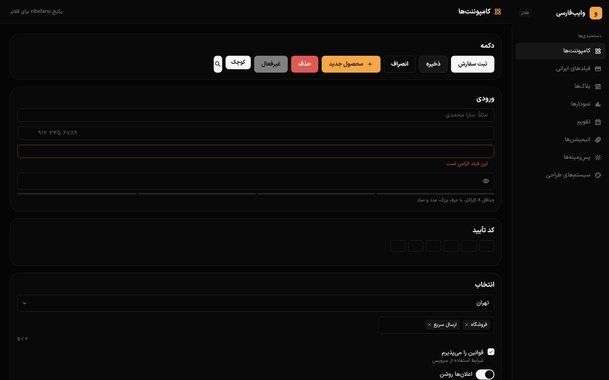
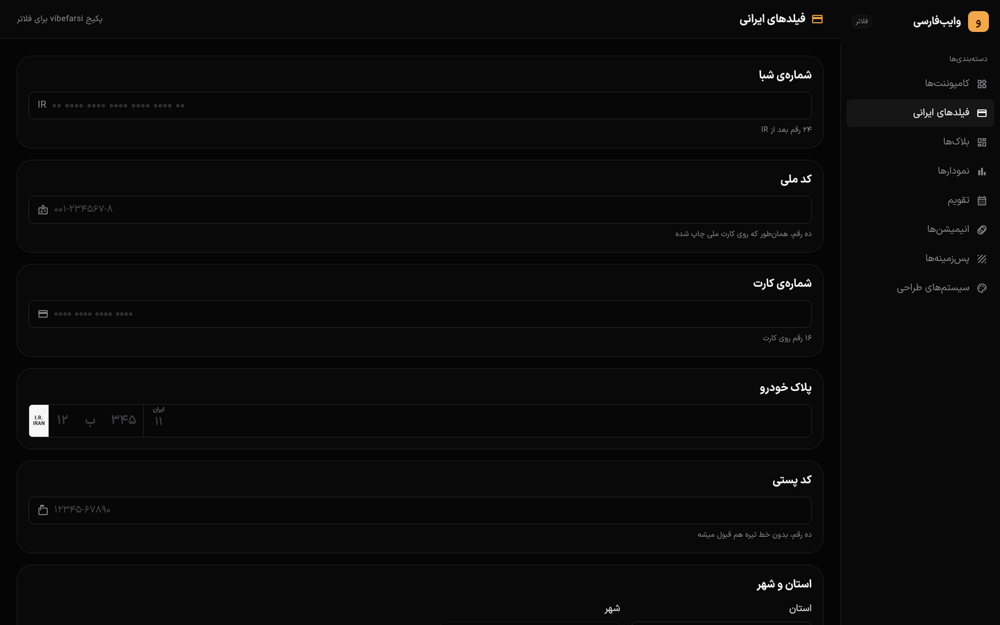
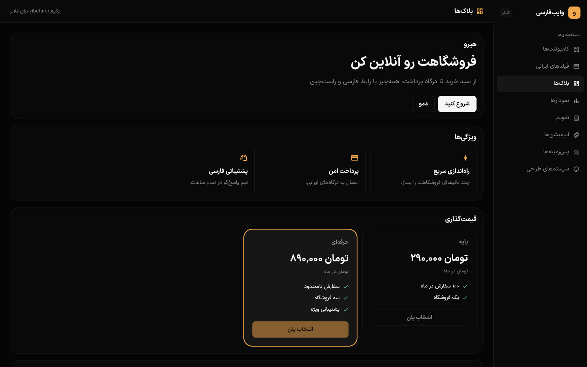
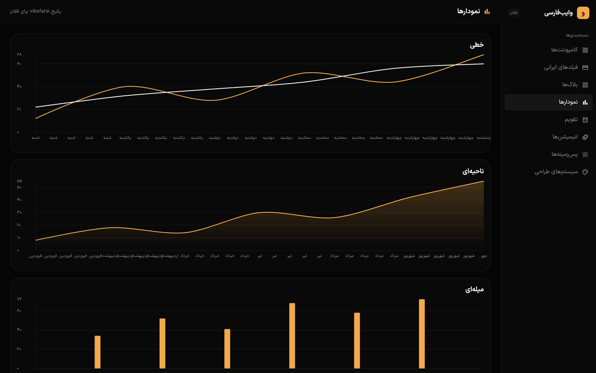
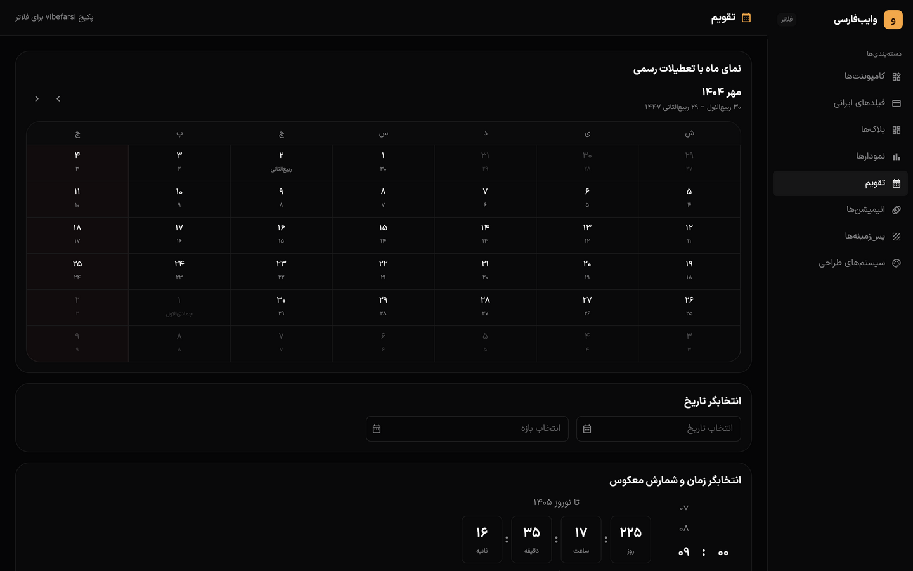
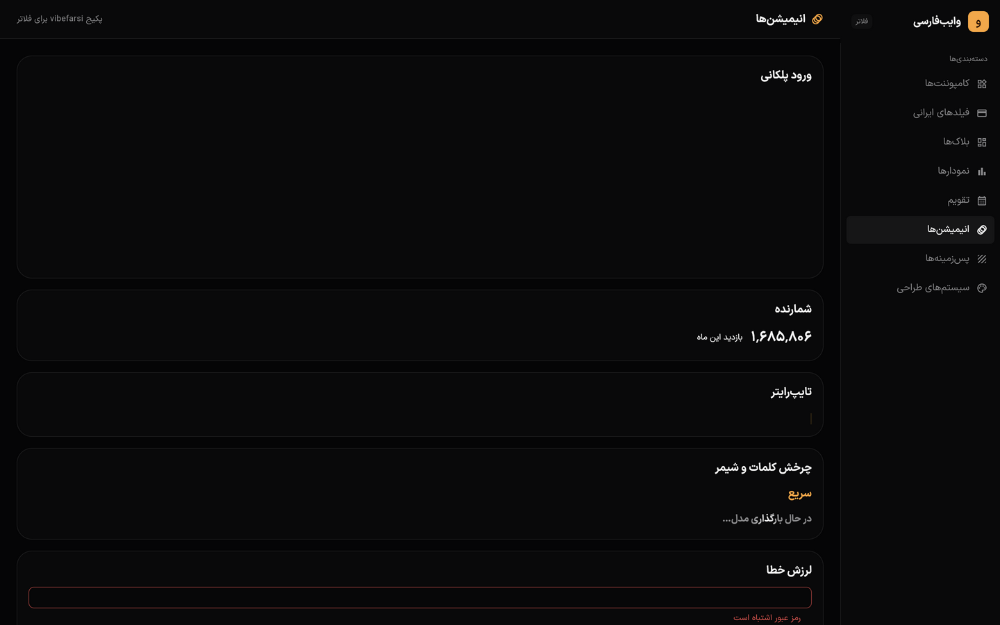
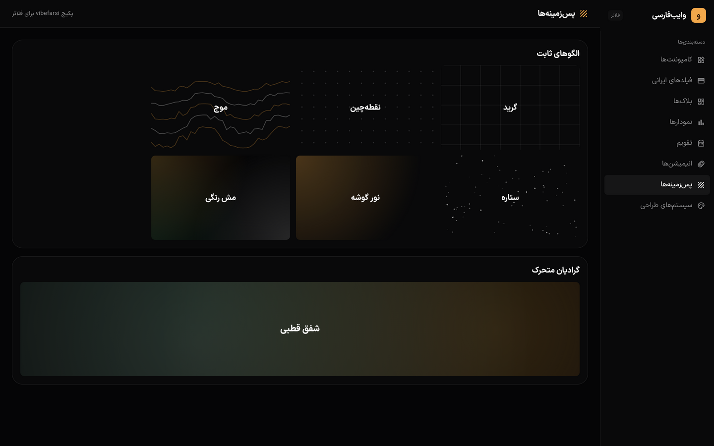
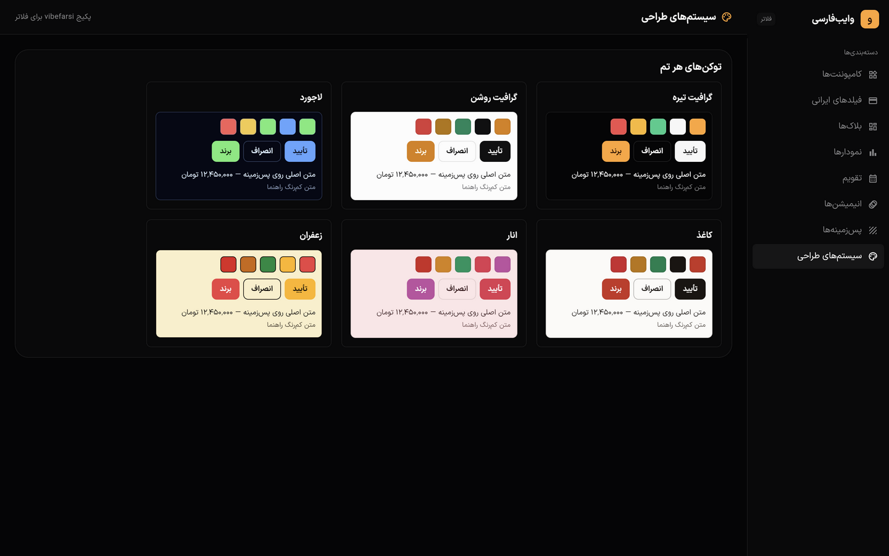

<div dir="rtl">

# وایب‌فارسی برای فلاتر 🎯

**کامپوننت‌های فارسی، برای توسعه‌دهنده‌های فلاتر و دارت.**

ابزارها و کتابخانه‌ها به انگلیسی فکر می‌کنن: فونت پیش‌فرض، اعداد لاتین و ویجت چپ‌چین. این مخزن کل رجیستری [vibefarsi.ir](https://vibefarsi.ir) را به **فلاتر** پورت کرده: همان زبان طراحی (توکن‌های گرافیت)، همان اعداد فارسی، همان تقویم شمسی و اعتبارسنجی ایرانی — این بار داخل ویجت‌های بومی فلاتر، بدون وابستگی اضافه.

هر ویجت از پایه راست‌چین است، فونت و ارتفاع خط برای فارسی تنظیم شده، تومان با رقم فارسی نمایش داده می‌شود و تقویم شمسی (با تعطیلات رسمی ایران) داخل خود ویجت‌هاست.

> Persian-first Flutter widgets: native RTL, Persian digits, Jalali calendar with official Iranian holidays, and Iranian-form validation (IBAN, national ID, card, plate, postal code). The rest of this README is in Persian; the commands are not.

| | | |
| --- | --- | --- |
|  |  |  |
|  |  |  |
|  |  | |

<sub>اپ نمایشی مخزن با تم گرافیت تیره — دسته‌بندی‌ها مثل سایت اصلی</sub>

## شروع سریع

</div>

```bash
git clone https://github.com/pedramgholizadeh/vibefarsiui-plus.git
```

<div dir="rtl">

وابستگی path در <code dir="ltr">pubspec.yaml</code> پروژه‌ی فلاتر خودتان:

</div>

```yaml
dependencies:
  vibefarsi:
    path: /path/to/vibefarsiui-plus
```

<div dir="rtl">

تم و جهت را یک‌بار ست کنید؛ از این به بعد همه‌ی ویجت‌ها راست‌چین و فارسی‌اند:

</div>

```dart
import 'package:vibefarsi/vibefarsi.dart';

MaterialApp(
  theme: VibeTheme.dark(),          // یا VibeTheme.light() / VibeTheme.withTokens(VibeTokens.saffron, ...)
  locale: const Locale("fa", "IR"),
  supportedLocales: const [Locale("fa", "IR")],
  localizationsDelegates: const [
    GlobalMaterialLocalizations.delegate,
    GlobalWidgetsLocalizations.delegate,
    GlobalCupertinoLocalizations.delegate,
  ],
  builder: (context, child) => Directionality(
    textDirection: TextDirection.rtl,
    child: child!,
  ),
)
```

<div dir="rtl">

بعد مثل هر ویجت فلاتری از کامپوننت‌ها استفاده کنید:

</div>

```dart
VibeButton(onPressed: submit, child: const Text("ثبت سفارش"))

VibePrice(amount: 12500000)                       // ۱۲٬۵۰۰٬۰۰۰ تومان

VibeDatePicker(
  value: _date,
  onChanged: (d) => setState(() => _date = d),    // تقویم شمسی با تعطیلات رسمی
)

VibeCardNumberInput(onChanged: (digits, valid, bank) { /* … */ })  // تشخیص بانک از BIN
```

<div dir="rtl">

## چه چیزهایی داره

| بخش | شامل |
| --- | --- |
| پایه | <code dir="ltr">fa / faNumber / formatToman / faFileSize / faPercent</code> · زمان نسبی فارسی |
| تقویم شمسی | <code dir="ltr">JalaliDate</code> (Borkowski، سال ۱ تا ۳۱۷۷) · هفته شنبه‌شروع · هجری قمری با جدول رسمی ماه‌های ایران · تعطیلات رسمی ۱۴۰۴/۱۴۰۵ (خورشیدی + قمری + چهارشنبه‌سوری) |
| اعتبارسنجی ایرانی | موبایل (+ تشخیص اپراتور) · شبا (mod-97 + نام بانک) · کد ملی · کارت بانکی (Luhn + BIN) · پلاک خودرو · کد پستی · تقسیمات کشوری ۳۱ استان |
| ویجت‌های UI | دکمه، ورودی و فیلدهای ایرانی (شبا، کد ملی، کارت، پلاک با ظاهر پلاک فلزی)، استان/شهر، سلکت و کمبوباکس با تطبیق نرم فارسی (ی/ك/آ و نیم‌فاصله)، OTP، جدول و جدول داده، تب، آکاردئون، سایدبار، توست، منو، پاپ‌آور، مودال، کروسل، فایل‌آپلود، برچسب‌ها و… |
| نمودارها | خطی، ناحیه‌ای، میله‌ای، دایره‌ای با `fl_chart` · رادار، گیج، قیف، هیت‌مپ شمسی، اسپارک‌لاین با CustomPaint — همه با ارقام فارسی |
| تقویم | نمای ماه با تعطیلات رنگی و تاریخ قمری دوم، انتخابگر تاریخ و بازه، نمای سال، شمارش معکوس، انتخاب نوبت، برنامه‌ی شیفت، گانت |
| آموزش | طرح دوره، کوییز تعاملی، تصویر نقطه‌دار، پوسته‌ی پخش‌کننده |
| انیمیشن‌ها | ورود پلکانی، شمارنده، تایپ‌رایتر، شیمر، چرخش کلمات، نوار متحرک، لرزش خطا |
| پس‌زمینه‌ها | گرید، نقطه‌چین، موج، ستاره، نور گوشه، مش رنگی، شفق متحرک — همه با CustomPaint |
| تم‌ها | ۶ تم رسمی: گرافیت (تیره/روشن)، لاجورد، کاغذ، انار، زعفران، فیروزه‌ای به‌صورت <code dir="ltr">VibeTokens</code> |

فهرست کامل و جست‌وجوپذیر کامپوننت‌ها: [vibefarsi.ir](https://vibefarsi.ir)

## قوانین طراحی (داخل خود ویجت‌ها)

- **راست‌چین واقعی.** چیدمان و آیکون‌ها از پایه جهت‌آگاه‌اند؛ `Directionality` کافی نیست.
- **اعداد فارسی.** هیچ عدد لاتینی در UI نمایش داده نمی‌شود؛ ورودی کاربر نرمال می‌شود.
- **رنگ فقط از توکن.** هر رنگ از `VibeTokens` می‌آید؛ تم تیره پیش‌فرض است.
- **زبان طراحی ثابت.** شعاع‌ها، انیمیشن ۲۰۰ میلی‌ثانیه‌ای و فشردگی ۰٫۹۸ همه از توکن می‌آیند.

## اپ نمایشی

```bash
cd example
flutter pub get
flutter run -d chrome    # یا -d macos
```

دسته‌بندی‌ها مثل سایت اصلی است و هر ویجت با داده‌ی واقعی فارسی نمایش داده می‌شود.

## توسعه

```bash
flutter pub get          # اگر pub.dev در دسترس نبود: PUB_HOSTED_URL=https://pub.flutter-io.cn flutter pub get
dart analyze .           # باید «No issues found!» بدهد
flutter test             # تست‌های foundation + ویجت
```

راهنمای کامل برای ایجنت‌ها و مشارکت‌کنندگان: [`AGENTS.md`](AGENTS.md) · قرارداد پورت وب → فلاتر و نگاشت کلاس‌ها: [`docs/PORTING.md`](docs/PORTING.md)

## لایسنس

[MIT](./LICENSE). پلن پولی نداریم و هیچ ویجتی قفل نیست. می‌خوایم ساختن یک رابط فارسی خوب، کار ساده‌ای باشه.

طراحی اصلی کامپوننت‌ها: [vibefarsi.ir](https://vibefarsi.ir) — این مخزن پورت رسمی آن به فلاتر است.

</div>
